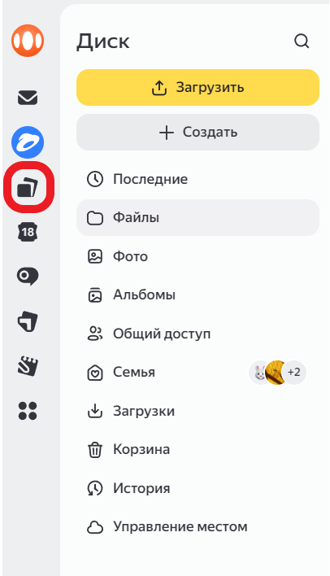
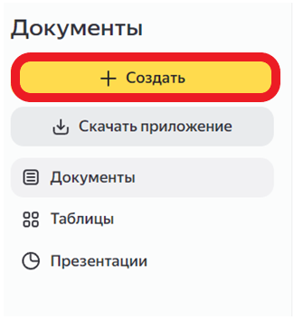
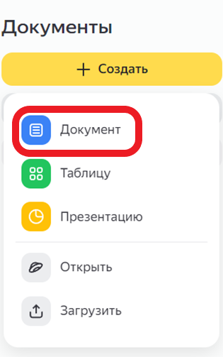
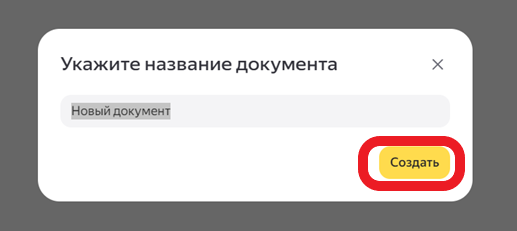
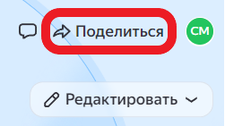
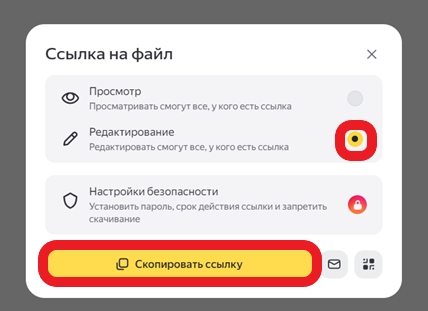
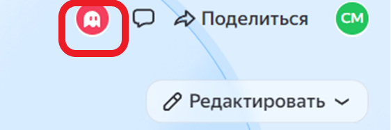

# **Как создать документ и настроить совместный доступ в Яндекс Диске**

1. Откройте страницу **Яндекс Диск** в своем аккаунте Яндекс. В колонке вкладок слева нажмите на иконку «**Документы**»:  

   
 
2. Во вкладке «**Документы**» нажмите кнопку «**Создать**»: 

   
 
3. После нажатия кнопки «**Создать**» выберите «**Документ**» в выпадающем окне: 

   

4. В открывшемся окне введите новое название документа и нажмите на кнопку «**Создать**»: 
 
   

Ваш документ готов к работе! 

5. Чтобы настроить совместный доступ и добавить соавтора нажмите на кнопку «**Поделиться**» в правом верхнем углу страницы документа: 
 
  

6. В открывшемся окне выберите «**Редактирование**» и нажмите на кнопку «**Скопировать ссылку**»: 
 
  

Полученную ссылку (к примеру: <https://disk.yandex.kz/i/WvtJlILnKhE7Vg>) направьте соавтору.
  
7.	Когда соавтор присоединится к редактированию документа, вы увидите его/ее имя или иконку в верхнем правом углу страницы: 

  
  